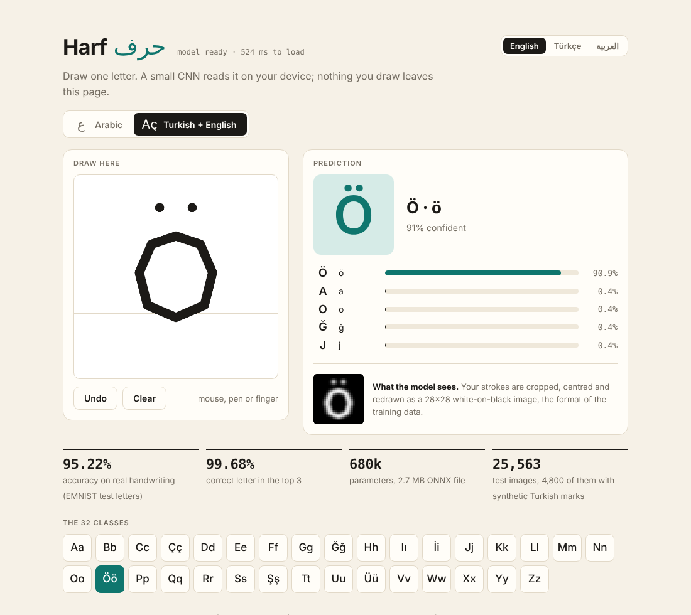
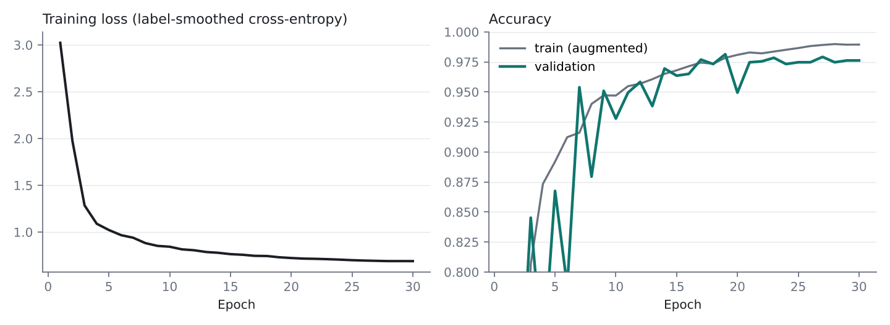
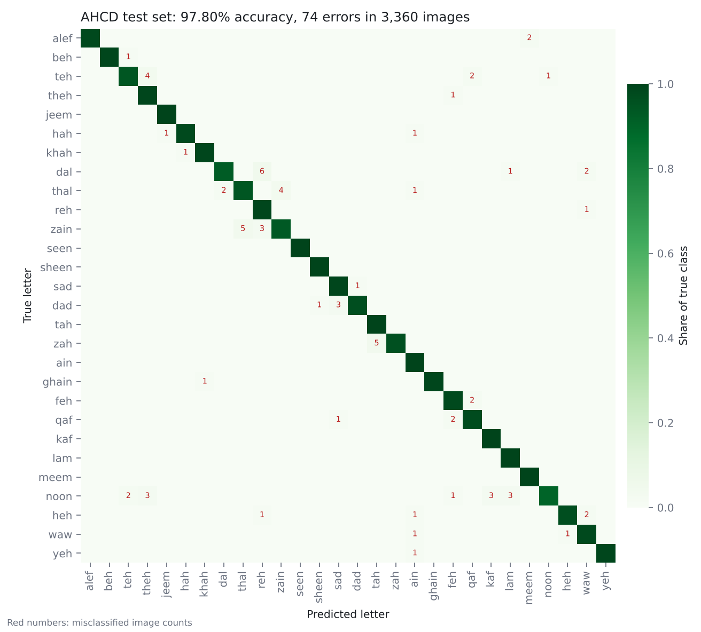
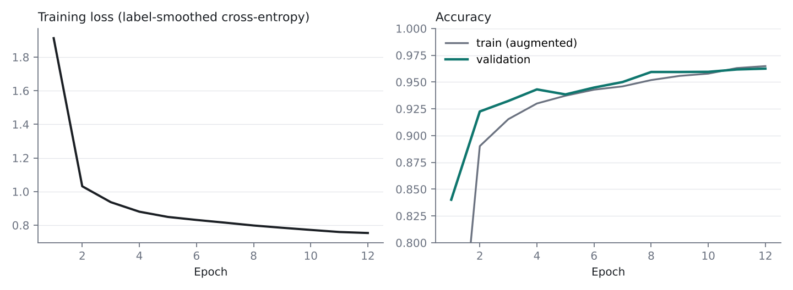
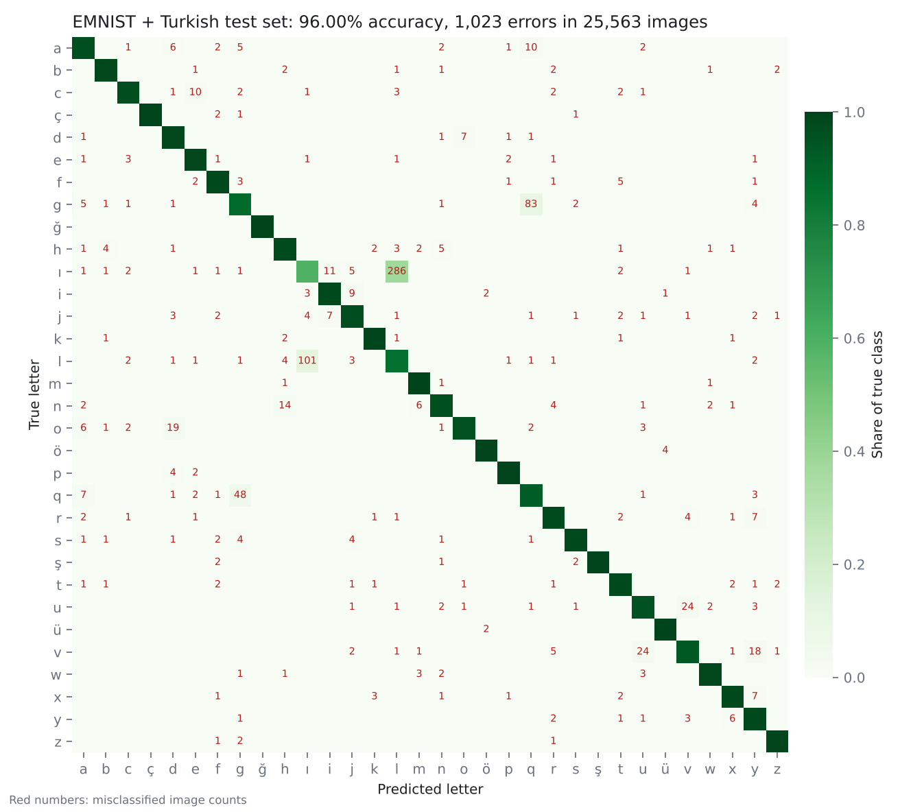

# Harf حرف

Handwritten letter recognition for **Arabic, Turkish and English**, with two small CNNs that run in the browser.

**[Live demo](https://readaloush.github.io/harf/)** · draw a letter, get a prediction, nothing leaves your device. The interface is in English, Turkish and Arabic and follows the visitor's browser language.



| | Arabic model | Latin model (Turkish + English) |
|---|---|---|
| Classes | 28 letters | 32 letters (26 English + ç ğ İ ö ş ü) |
| Training data | AHCD, 13,440 scans | EMNIST Letters + synthesised Turkish marks, 64,000 images |
| Test accuracy | **97.80%** (3,360 images) | **95.22%** on real handwriting (20,763 images) |
| Top-3 accuracy | 99.85% | 99.68% |
| Parameters / ONNX size | 680k / 2.7 MB | 680k / 2.7 MB |
| Training time, 2-core CPU | about 18 min | about 27 min |

For reference, the AHCD authors report 94.9% on the same Arabic test set.

## How it works

```
dataset images ──> PyTorch training ──> ONNX export ──> onnxruntime-web (WASM) in the page
                                                          ▲
                          canvas strokes ──> crop, centre, redraw at model resolution
```

**Model.** `HarfNet` is a five-block residual CNN (32 → 64 → 128 channels) with batch norm, global average pooling and a linear head. Both models use the same architecture. See [`src/model.py`](src/model.py).

**Training.** AdamW with a one-cycle learning rate schedule and label smoothing 0.1. Augmentation is deliberately mild: small rotation, scale, shear and shift, plus random stroke thickening and thinning. No flips and no heavy distortion, because many letters in both scripts differ only by a dot or a small mark.

**Validation.** Checkpoints are picked on a validation split held out of the training data. For Arabic it is the last 6 blocks of the training file, kept whole so near-duplicate samples of the same handwriting do not sit on both sides. Each test set is used once, for the final numbers.

**Browser inference.** The page stores your strokes as vectors, fits their bounding box to the letter size found in the dataset, and redraws them at the model's resolution with a matching stroke width. ONNX outputs match PyTorch to within 1e-6, and both in-browser models are checked against real test images in headless Chrome ([`tests/browser_check.py`](tests/browser_check.py)).

## Turkish letters: how they were made, and what that means

No public handwriting dataset covers ç, ğ, İ, ö, ş and ü. EMNIST Letters has only the 26 English letters, with upper and lower case merged into one class each.

So the six Turkish classes are **synthetic**: [`src/latin.py`](src/latin.py) takes real EMNIST letters (c, g, I, o, s, u), draws a randomised cedilla, breve or dot(s) on them, and re-normalises the result the way EMNIST normalises every glyph. The 260 real dotted i samples found in EMNIST's "I" class are moved to the İ/i class.

What this means for the numbers:

| Subset of the Latin test set | Images | Accuracy |
|---|---|---|
| Real handwriting (26 EMNIST letters) | 20,763 | 95.22% |
| Synthetic Turkish marks | 4,800 | 99.38% |
| All | 25,563 | 96.00% |

The 99.38% only says the model separates my computer-drawn marks from unmarked letters. It is **not** a measurement on real Turkish handwriting, and I report 95.22% as the headline for that reason. Collecting real samples of the six letters is the obvious next step.

Turkish also splits I/ı from İ/i. A dotless ı is a plain vertical stroke, which is what a lowercase l looks like too: that one pair accounts for 387 of the 1,023 Latin test errors, and dotless-ı recall is only 59%.

## Results

### Arabic





Most frequent errors: dal د → reh ر (6), zain ز → thal ذ (5), zah ظ → tah ط (5), thal ذ → zain ز (4), teh ت → theh ث (4).

### Latin (Turkish + English)





Most frequent errors: ı → l (286), l → ı (101), g → q (83), q → g (48), u ↔ v (24 each).

Per-class precision and recall: [`results/harfnet_metrics.json`](results/harfnet_metrics.json), [`results/harfnet_latin_metrics.json`](results/harfnet_latin_metrics.json).

## Limitations

- Both models learned from scanned pen writing. Mouse and finger drawings look different, so expect lower accuracy in the demo than on the test sets. I have not measured demo accuracy on real users.
- The Turkish-specific letters were trained and tested on synthetic marks only (see above).
- Upper and lower case are one class per letter in the Latin model, as in EMNIST Letters.
- Arabic covers the 28 isolated letter forms only: no initial, medial or final forms, no hamza variants. Neither model reads digits or words.
- Each model comes from a single training run with one seed.

## Reproduce

```bash
pip install -r requirements.txt

python -m src.train --dataset arabic --epochs 30    # downloads AHCD on first run
python -m src.evaluate --dataset arabic
python -m src.export_onnx --dataset arabic

python -m src.train --dataset latin --epochs 12     # downloads EMNIST Letters on first run
python -m src.evaluate --dataset latin
python -m src.export_onnx --dataset latin

python -m http.server 8000 -d docs                  # open http://localhost:8000
```

The demo has to be served over HTTP; opening `docs/index.html` as a file will not load the models.

## Repository layout

```
src/        datasets and augmentation, Turkish mark synthesis, model, training, evaluation, ONNX export
docs/       the web demo (served by GitHub Pages) and the two ONNX models
results/    checkpoints, metrics, training logs and figures
tests/      headless-browser check of the demo
```

## Data and credits

- [Arabic Handwritten Characters Dataset](https://github.com/mloey/Arabic-Handwritten-Characters-Dataset): Ahmed El-Sawy, Mohamed Loey and Hazem El-Bakry, *Arabic Handwritten Characters Recognition using Convolutional Neural Network*, WSEAS Transactions on Computer Research, 2017.
- EMNIST Letters: Gregory Cohen, Saeed Afshar, Jonathan Tapson and André van Schaik, *EMNIST: an extension of MNIST to handwritten letters*, 2017.

Neither dataset is redistributed here; the training script downloads them.

The demo loads [onnxruntime-web](https://github.com/microsoft/onnxruntime) 1.20.1 (MIT licence) from the jsDelivr CDN.

Code in this repository is MIT licensed.
